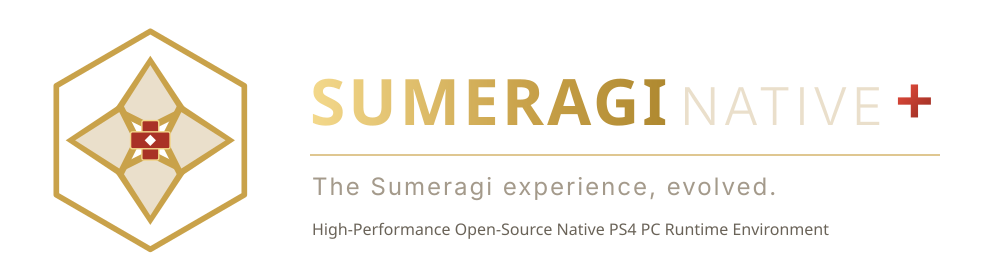
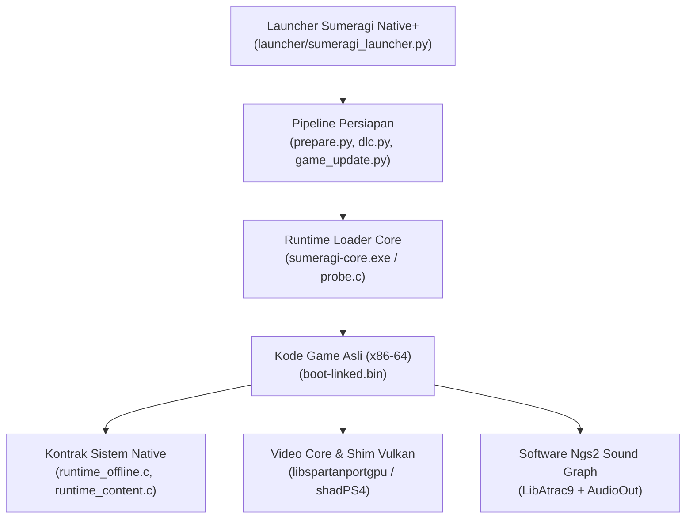

# Sumeragi Native+

<div align="center">



<br><br>

*The Sumeragi experience, evolved.*

[](#build-dari-source-code)
[](#arsitektur-teknis)
[](#pengaturan-launcher)
[](#fitur-utama)
[](LICENSE)
[](https://github.com/i7Exceed/sumeragi-native-plus)

</div>

---

[English](README.md) | **Bahasa Indonesia**

**Sumeragi Native+** adalah port PC native dan launcher modern independen berbasis komunitas untuk **Sengoku Basara 4 Sumeragi** (PlayStation 4, `CUSA01159`) pada sistem operasi Windows 10/11 64-bit.

Kode instruksi mesin x86-64 asli dari game dieksekusi langsung pada prosesor PC tanpa beban emulasi atau interpreter. Library sistem PlayStation 4 diimplementasikan ulang fungsi demi fungsi ke dalam bahasa C native, dan perintah render GPU serta shader GCN diterjemahkan langsung ke Vulkan 1.3 secara real-time.

---

> ### ⚠️ Pernyataan Penyangkalan Hukum & Kepatuhan Hak Cipta
>
> - **Pengembangan Komunitas Independen**: Sumeragi Native+ adalah proyek sumber terbuka independen yang dikembangkan dan dikelola oleh **i7Exceed**, dibangun di atas fondasi kontribusi terdahulu oleh **Razz** (*Basara 4 Native PC*), **Felipe Prado** (*SpartanPort*), **Supermedo** & **deadinside28** (*bloodborne_pc*), serta **Tim shadPS4**.
> - **Tidak Terafiliasi Secara Resmi**: Proyek ini **TIDAK** berafiliasi dengan, didukung oleh, disponsori oleh, atau merupakan produk resmi dari **Capcom Co., Ltd.**, **Sony Interactive Entertainment Inc.**, maupun anak perusahaan terkait.
> - **Identifikasi Kompatibilitas Nominatif**: Penyebutan judul game (*"Sengoku Basara 4 Sumeragi"*), nama platform (*"PlayStation 4"*, *"PS4"*), dan merek dagang perusahaan semata-mata digunakan secara faktual sebagai rujukan teknis untuk mengidentifikasi kompatibilitas perangkat lunak.
> - **NOL File Game Berhak Cipta yang Didistribusikan**: Repositori ini dan arsip rilis resminya **sama sekali tidak mendistribusikan** dump game, executable terdekripsi, kunci enkripsi firmware konsol, file lisensi konsol (`.rif`/`.rap`), paket DLC, tekstur, audio, model 3D, maupun aset media game berhak cipta.
> - **Konten Legal Milik Pengguna**: Pengguna wajib mengekstrak dan menyediakan salinan file game legal hasil dump dari konsol PlayStation 4 milik sendiri.
> - **Tanpa Jaminan Tambahan**: Fitur eksperimental dan pembuka batasan performa disediakan *"sebagaimana adanya"* di bawah lisensi GNU General Public License v2.0 (atau lebih baru), tanpa jaminan apa pun di luar ketentuan lisensi tersebut.
>
> Rincian lengkap audit kepatuhan, lisensi komponen, dan asal-usul kode dapat dibaca pada [docs/COPYRIGHT_AND_LICENSE_AUDIT.md](docs/COPYRIGHT_AND_LICENSE_AUDIT.md) dan [NOTICE.md](NOTICE.md).

---

## Daftar Isi

- [Identitas Visual & Desain](#identitas-visual--desain)
- [Fitur Utama](#fitur-utama)
- [Spesifikasi Sistem](#spesifikasi-sistem)
- [Panduan Singkat: Unduh & Mainkan](#panduan-singkat-unduh--mainkan)
- [Pengaturan Launcher](#pengaturan-launcher)
- [Menu In-Game & Tombol Cepat](#menu-in-game--tombol-cepat)
- [Konfigurasi Controller](#konfigurasi-controller)
- [Arsitektur Teknis](#arsitektur-teknis)
- [Build dari Source Code](#build-dari-source-code)
- [Paket Rilis & Validasi Kepatuhan](#paket-rilis--validasi-kepatuhan)
- [Troubleshooting & Log](#troubleshooting--log)
- [Kredit & Garis Keturunan Upstream](#kredit--garis-keturunan-upstream)
- [Lisensi](#lisensi)

---

## Identitas Visual & Desain

Sumeragi Native+ menghadirkan identitas visual orisinal dengan estetika desktop technical bernuansa klasik Jepang:
- **Palet Warna**: Dark charcoal (`#12100e`, `#1c1916`), Warm ivory (`#eadfcb`), Muted antique gold (`#c9a24a`), dan Aksen Lacquer crimson (`#a93226`).
- **Ikon Vektor Orisinal**: Gambar vektor SVG orisinal (`assets/sumeragi_icon.svg` dan `assets/sumeragi_logo.svg`) yang memadukan lambang klan samurai (*kamon*) geometris abstrak tanpa menggunakan atau menjiplak aset hak cipta Capcom maupun Sony.
- **Ikon Windows Multi-Resolusi**: Ikon aplikasi Windows (`launcher/sumeragi.ico`) dengan dukungan resolusi 16px hingga 256px dengan transparansi alfa bersih.

---

## Fitur Utama

- **Eksekusi CPU 100% Native**: Tanpa emulasi CPU, tanpa kompilasi JIT, dan tanpa lag. Instruksi x86-64 binary game berjalan langsung di core prosesor PC dengan performa maksimal.
- **Sistem Overlay Update Game Terpisah**: Pasang dan mainkan update game (v1.01, v1.02) secara non-destruktif tanpa menyentuh atau merusak folder dump game dasar.
- **Dukungan DLC Lokal & Add-on (Tahap 2)**: Deteksi otomatis, validasi aman, manifest binary terversi (`B4ADD001`), enumerasi AppContent (`sceAppContentGetAddcontInfoList`), dan mounting guest (`/addcont0` ... `/addcont15`) untuk konten DLC lokal tanpa bypass lisensi palsu.
- **Kompatibilitas Binary Ganda**: Resolusi dan eksekusi mulus untuk file biner kanonikal (`sumeragi-core.exe`, `sumeragi-pad-mapper.exe`) maupun biner warisan (`basara4-core.exe`, `basara4-pad-mapper.exe`), serta migrasi otomatis konfigurasi `sumeragi.ini` / `basara4.ini`.
- **Software Ngs2 Audio Engine Kustom**: Implementasi sound graph Ngs2 untuk menangani streaming multi-channel ATRAC9, decoding LibAtrac9, sintesis suara, pemutaran PCM, dan submixing.
- **Translasi Grafis Vulkan 1.3**: Menerjemahkan shader AMD GCN PS4 ke SPIR-V / Vulkan secara langsung dengan performa tinggi.
- **FPS Unlimited & High-Refresh Rate**: Patch memori otomatis (`basara4_patches.py`) yang mematikan pembatas FPS bawaan game (bisa main di 90, 120, 144, 165, 240, hingga unlimited FPS).
- **AMD FidelityFX Super Resolution (FSR 1)** & **RCAS Sharpening**: Upscaling bersih ke 1440p atau 4K.
- **Anisotropic Filtering (hingga 16x)**: Mempertajam tekstur arena pertempuran dan lantai dari sudut kamera miring.
- **Launcher Modern Berbasis Kartu**: Antarmuka modern dengan bilah sisi responsif, deteksi versi/SFO otomatis, pemilih DLC, dan alat konfigurasi gamepad terpadu.
- **Sistem Piala (Trophies) Offline & Manager**: Dukungan penuh piala untuk Sengoku Basara 4 Sumeragi (43 piala). Dilengkapi notifikasi animasi real-time (toast), overlay daftar piala in-game (`F8` / `R3+R2`), piala platinum otomatis, serta pengelola piala pada launcher dengan badge kategori, filter, progres bar, dan reset aman dengan backup. Baca [docs/TROPHIES.md](docs/TROPHIES.md).
- **Validator Rilis Otomatis**: Skrip validasi statis (`packaging/validate_release.py`) untuk memastikan tidak ada aset game ilegal atau cache yang masuk ke paket distribusi maupun pelacakan Git.

---

## Spesifikasi Sistem

| Komponen | Minimum | Rekomendasi |
|---|---|---|
| **Sistem Operasi** | Windows 10 64-bit (1903 ke atas) | Windows 10/11 64-bit |
| **Prosesor (CPU)** | 64-bit x86-64 dengan AVX / AVX2 (Intel Core Gen 4+ / AMD Ryzen) | 6 Core / 12 Thread modern (Intel Gen 10+ / Ryzen 3000+) |
| **Kartu Grafis (GPU)** | GPU mendukung Vulkan 1.3 (GTX 1060 6GB / RX 580) | RTX 2060 / RX 6600 atau lebih baru |
| **RAM** | 8 GB RAM | 16 GB RAM (dual-channel) |
| **Penyimpanan** | ~20 GB ruang kosong (SSD disarankan) | NVMe SSD berkecepatan tinggi |
| **File Game** | Dump game legal Sengoku Basara 4 Sumeragi (`CUSA01159`) | Dump dengan update terpasang |

---

## Panduan Singkat: Unduh & Mainkan

### 1. Unduh Paket
Unduh arsip rilis terbaru `sumeragi-native-plus-windows.zip` dari halaman GitHub Releases, lalu ekstrak ke folder pilihan Anda (misal `C:\Games\SumeragiNativePlus`).

### 2. Masukkan Dump Game
Salin folder dump game PS4 legal Anda (yang berisi `eboot.bin`, `sce_module\`, dan `sce_sys\`) ke dalam folder `game\`, atau klik tombol **Browse** di launcher untuk memilih lokasinya di disk Anda.

### 3. (Opsional) Masukkan Folder Update & DLC
- **Update Folder**: Pilih folder update yang sudah diekstrak (misal v1.02) pada kolom **Update Folder**.
- **DLC Folder**: Pilih folder root DLC lokal Anda pada kolom **DLC Folder**.
  Struktur folder DLC yang didukung:
  ```text
  <DLC_ROOT>/CUSA01159/<ENTITLEMENT_ID>/<file konten>
  ```
  *Contoh:*
  ```text
  dlc/
  └── CUSA01159/
      ├── COSTUME000000001/
      │   └── data.arc
      └── WEAPON0000000001/
          └── data.arc
  ```

### 4. Jalankan Game
1. Buka **`Sumeragi Native+.exe`**.
2. Tekan **PLAY**. Peluncuran pertama akan menyiapkan game image dari `eboot.bin` (~1 menit) ke folder `out\`.
3. Untuk langsung membuka game dengan konfigurasi terakhir tanpa membuka GUI launcher, klik **`Play Sumeragi Native+.cmd`**.

---

## Pengaturan Launcher

Launcher menyediakan kendali grafis dan runtime terperinci:
- **Mode Layar**: Windowed, Borderless Fullscreen, Exclusive Fullscreen.
- **Ukuran Layar**: Native (1080p), 720p, 900p, 1440p, 1800p, 4K.
- **Upscaling**: Off, atau AMD FidelityFX Super Resolution 1 (FSR 1).
- **Pembatas Frame Rate**: 60 (default), 90, 120, 144, 165, 240, atau Unlimited.
- **Peningkatan Grafis**: VSync, ketajaman RCAS, anisotropic filtering (2x hingga 16x).
- **Alat Controller**: Pemetaan penuh, pemetaan analog saja, atau reset mapping tersimpan.

Pengaturan disimpan secara otomatis di `user\sumeragi.ini` (dengan migrasi otomatis dari `basara4.ini` / `spartanport.ini`).

---

## Menu In-Game & Tombol Cepat

Buka menu konfigurasi in-game saat permainan sedang berlangsung:
- **Keyboard**: Tekan `Insert`.
- **Controller**: Tekan `R3 + L2` (PlayStation) atau `RS + LT` (Xbox).
- **Navigasi Tab**: Gunakan `L1 / R1` atau `Q / E`.
- **Screenshot**: Tekan `F12` (tersimpan di `user\screenshots\`).

---

## Arsitektur Teknis

Sumeragi Native+ menggunakan arsitektur modular runtime native:



---

## Build dari Source Code

### Prasyarat
- Windows 10/11 64-bit
- [MSYS2](https://www.msys2.org/) dengan environment `CLANG64`:
  ```bash
  pacman -S --needed mingw-w64-clang-x86_64-clang mingw-w64-clang-x86_64-cmake \
      mingw-w64-clang-x86_64-ninja mingw-w64-clang-x86_64-pkg-config \
      mingw-w64-clang-x86_64-vulkan-loader mingw-w64-clang-x86_64-vulkan-headers \
      mingw-w64-clang-x86_64-sdl3 mingw-w64-clang-x86_64-ffmpeg
  ```
- Windows Python 3.11+ dengan modul `pyinstaller` dan `pillow`.

### Tahapan Kompilasi
1. Clone repositori:
   ```bash
   git clone --recursive https://github.com/i7Exceed/sumeragi-native-plus.git
   cd sumeragi-native-plus
   ```
2. Buka terminal MSYS2 CLANG64 shell, jalankan:
   ```bash
   bash build.sh
   ```
   *Jalankan pengujian:* `bash build.sh --test`

3. Di PowerShell, bangun paket rilis Windows:
   ```powershell
   python packaging/sumeragi/make_package.py --out dist/sumeragi-native-plus-windows
   ```

4. Uji kepatuhan paket rilis:
   ```powershell
   python packaging/validate_release.py --path dist/sumeragi-native-plus-windows
   ```

---

## Troubleshooting & Log

Saat melaporkan kendala atau bug, sertakan file log dari folder `user\`:
- **`user\last_run.log`**: Log diagnostik runtime (inisialisasi, kompilasi shader GPU, crash dump).
- **`user\prepare.log`**: Output proses persiapan gambar game dari eboot.bin.
- **`user\audio_debug.log`**: Rincian alokasi suara Ngs2, status feed streaming, dan buffer (aktifkan "Audio debug log" di launcher).

Untuk meringkas log audio dari command line:
```bash
python tools/audio_log_summary.py user/audio_debug.log
```

---

## Kredit & Garis Keturunan Upstream

| Proyek / Komponen | Penulis | Peran & Kontribusi | Lisensi |
|---|---|---|---|
| **Sumeragi Native+** | **[i7Exceed](https://github.com/i7Exceed)** | Pengelola proyek, identitas visual orisinal, subsistem overlay update terpisah, integrasi DLC lokal (Tahap 2), validator kepatuhan rilis, kompatibilitas binary ganda, antarmuka modern | GPL-2.0+ |
| **Port PC Basara 4** | **Razz** | Penulis port PC, reverse-engineering kontrak sistem Basara 4 (`runtime_offline.c`), implementasi software Ngs2, hardening LibAtrac9, GUI launcher awal, patch unlock FPS, mapper pad, packaging | GPL-2.0+ |
| **SpartanPort** (`gow3_pc`) | **Felipe Prado** | Arsitektur runtime native dasar, probe loader, dan exception handling | GPL-2.0+ |
| **bloodborne_pc** | **Supermedo** & **deadinside28** | Metodologi porting native PS4 ke PC dan library runtime awal | GPL-2.0+ |
| **shadPS4** | **Tim shadPS4** | Core GPU, translasi shader ke SPIR-V/Vulkan, tabel NID (`aerolib`) | GPL-2.0+ |
| **LibAtrac9** | **Alexander Barney** | Library dekompresi audio ATRAC9 | MIT |
| **Perbaikan Render GPU** | **cuesta4** | Perbaikan emulasi blending, depth/stencil, dan aliasing pada core video | GPL-2.0+ |
| **FSR-Vulkan** | **FireBurn** / AMD | Integrasi Vulkan untuk FidelityFX Super Resolution | MIT |
| **Library Tambahan** | Berbagai Penulis | SDL3, Dear ImGui, Vulkan Memory Allocator, sirit, xbyak, miniz | Lisensi masing-masing |

Pemberitahuan hukum lengkap, atribusi, dan deklarasi hak cipta terdokumentasi di [NOTICE.md](NOTICE.md).

---

## Lisensi

Proyek ini dilisensikan di bawah **GNU General Public License v2.0 atau lebih baru** ([LICENSE](LICENSE)).
- Kontribusi orisinal Sumeragi Native+, identitas vektor, overlay update, dan subsistem DLC lokal adalah Hak Cipta (C) 2026 i7Exceed di bawah GPL-2.0-or-later.
- Kode modifikasi runtime, sound graph Ngs2, dan launcher karya Razz adalah Hak Cipta (C) 2026 Razz di bawah GPL-2.0-or-later.
- Komponen upstream dan pihak ketiga tetap tunduk pada lisensi masing-masing sebagaimana dirinci pada [NOTICE.md](NOTICE.md) dan [docs/COPYRIGHT_AND_LICENSE_AUDIT.md](docs/COPYRIGHT_AND_LICENSE_AUDIT.md).
