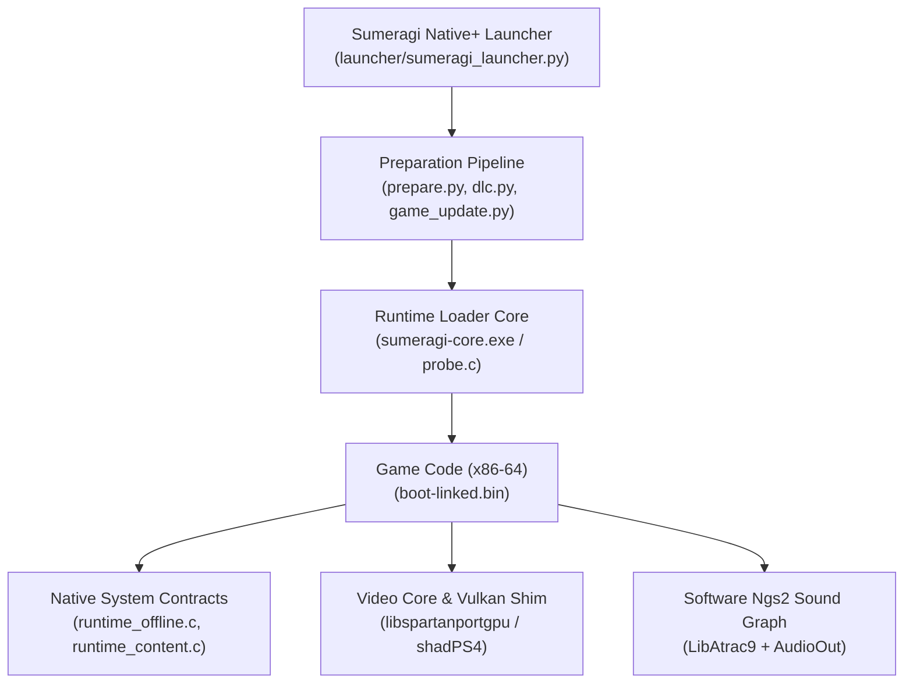

# Sumeragi Native+

<div align="center">


<br><br>

*The Sumeragi experience, evolved.*

[](#building-from-source)
[](#technical-architecture)
[](#launcher-settings)
[](#features--highlights)
[](LICENSE)
[](https://github.com/i7Exceed/sumeragi-native-plus)

</div>

---

**English** | [Bahasa Indonesia](README.id.md)

**Sumeragi Native+** is an independent, community-developed native PC port and modern launcher for **Sengoku Basara 4 Sumeragi** (PlayStation 4, `CUSA01159`) on 64-bit Windows 10/11.

The game's compiled x86-64 machine instructions execute directly on your host processor with zero virtualization overhead. Missing PlayStation 4 system libraries are cleanly implemented in native C, and GPU draw calls and GCN shaders are translated to Vulkan 1.3 in real time.

---

> ### ⚠️ Legal Disclaimer & Compliance Notice
>
> - **Independent Community Development**: Sumeragi Native+ is an independent open-source project maintained by **i7Exceed**, building upon upstream contributions by **Razz** (*Basara 4 Native PC*), **Felipe Prado** (*SpartanPort*), **Supermedo** & **deadinside28** (*bloodborne_pc*), and the **shadPS4 Team**.
> - **No Official Affiliation**: This project is **NOT** affiliated with, endorsed by, sponsored by, or an official product of **Capcom Co., Ltd.**, **Sony Interactive Entertainment Inc.**, or any of their affiliates.
> - **Nominative Identification**: Any game titles (*"Sengoku Basara 4 Sumeragi"*), platform names (*"PlayStation 4"*, *"PS4"*), and company names are used strictly as factual, nominative references to identify intended technical compatibility.
> - **Zero Game Files Distributed**: This repository and its official release packages **do not distribute** proprietary game dumps, decrypted executables, console firmware keys, console licenses (`.rif`/`.rap`), DLC packages, textures, audio, 3D models, or copyrighted game media.
> - **User-Provided Content**: Users must dump and provide their own legally purchased copy of the game from their own PlayStation 4 console.
> - **Warranty Notice**: Experimental features and performance unlocks are provided *"as is"* under the GNU General Public License v2.0 (or later), without warranty of any kind.
>
> For full component licensing details, source provenance, and audit findings, consult [docs/COPYRIGHT_AND_LICENSE_AUDIT.md](docs/COPYRIGHT_AND_LICENSE_AUDIT.md) and [NOTICE.md](NOTICE.md).

---

## Contents

- [Visual Identity & Design Philosophy](#visual-identity--design-philosophy)
- [Features & Highlights](#features--highlights)
- [System Requirements](#system-requirements)
- [Quick Start: Download & Play](#quick-start-download--play)
- [Launcher Settings & Configuration](#launcher-settings--configuration)
- [In-Game Menu & Hotkeys](#in-game-menu--hotkeys)
- [Controller Configuration](#controller-configuration)
- [Technical Architecture](#technical-architecture)
- [Building from Source](#building-from-source)
- [Release Packaging & Compliance](#release-packaging--compliance)
- [Troubleshooting & Logs](#troubleshooting--logs)
- [Credits & Upstream Lineage](#credits--upstream-lineage)
- [License](#license)

---

## Visual Identity & Design Philosophy

Sumeragi Native+ introduces an original aesthetic rooted in classical Japanese martial iconography fused with modern high-performance engineering:
- **Palette**: Dark charcoal (`#12100e`, `#1c1916`), Warm ivory (`#eadfcb`), Muted antique gold (`#c9a24a`), and Lacquer crimson (`#a93226`).
- **Original Vector Iconography**: Wholly original vector SVG artwork (`assets/sumeragi_icon.svg` and `assets/sumeragi_logo.svg`) representing an abstract geometric samurai crest (*kamon*), containing zero proprietary or traced Capcom / Sony artwork.
- **Application Icons**: Multi-resolution Windows application icon (`launcher/sumeragi.ico`) supporting 16px to 256px displays with transparent alpha layers.

---

## Features & Highlights

- **100% Native CPU Execution**: Zero CPU emulation, binary translation, or JIT lag. The game's x86-64 instructions execute natively at native CPU speeds.
- **Separate Game Update Overlay**: Mount and play updated versions (v1.01, v1.02) non-destructively without altering your clean base game dump directory.
- **Local DLC Discovery & Mounting (Stage 2)**: Reliable discovery, entitlement validation, versioned binary manifest (`B4ADD001`), AppContent enumeration (`sceAppContentGetAddcontInfoList`), and guest mounting (`/addcont0` ... `/addcont15`) for locally extracted add-on content without synthetic license bypasses.
- **Dual-Binary Runtime Compatibility**: Seamless discovery and execution of both canonical (`sumeragi-core.exe`, `sumeragi-pad-mapper.exe`) and legacy (`basara4-core.exe`, `basara4-pad-mapper.exe`) runtime executables and configuration files.
- **Custom Software Ngs2 Audio Engine**: Implemented software Ngs2 sound graph handling multi-channel ATRAC9 streaming, LibAtrac9 decoding, voice synthesis, PCM playback, and submixing.
- **Vulkan 1.3 Graphics Translation**: High-performance translation of PlayStation 4 AMD GCN shader bytecode and draw calls directly into SPIR-V / Vulkan.
- **High-Refresh & Uncapped Framerates**: Integrated memory patch (`basara4_patches.py`) that scans for the engine's internal frame limiter and disables it, unlocking 90, 120, 144, 165, 240, and uncapped FPS on high-refresh displays.
- **AMD FidelityFX Super Resolution (FSR 1)** & **RCAS Sharpening**: Upscale cleanly from 720p/900p/1080p to 1440p or 4K.
- **Anisotropic Filtering (up to 16x)**: Greatly enhances floor and terrain texture clarity across battlefields.
- **Modernized Card-Based Launcher**: Built with a clean native dark aesthetic, responsive sidebar, DLC discovery UI, and controller configuration tools.
- **Offline Trophy System & Manager**: Complete trophy support for Sengoku Basara 4 Sumeragi (43 trophies). Includes live animated toast notifications, in-game trophy browser overlay (`F8` / `R3+R2`), automatic platinum unlock, and dedicated launcher manager with category badges, filtering, progress tracking, and backup reset. See [docs/TROPHIES.md](docs/TROPHIES.md).
- **Automated Release Compliance Validation**: Bundled static validator (`packaging/validate_release.py`) to guarantee zero proprietary game assets enter distributions or git tracking.

---

## System Requirements

| Component | Minimum | Recommended |
|---|---|---|
| **Operating System** | Windows 10 64-bit (1903 or newer) | Windows 10/11 64-bit (latest) |
| **Processor (CPU)** | 64-bit x86-64 with AVX / AVX2 (Intel Core 4th Gen+ / AMD Ryzen) | Modern 6-core / 12-thread CPU (Intel 10th Gen+ / Ryzen 3000+) |
| **Graphics (GPU)** | Vulkan 1.3 compliant GPU (GTX 1060 6GB / RX 580) | RTX 2060 / RX 6600 or higher |
| **System Memory** | 8 GB RAM | 16 GB RAM (dual-channel) |
| **Storage** | ~20 GB free space (SSD recommended) | Fast NVMe SSD |
| **Game Files** | Legally obtained dump of Sengoku Basara 4 Sumeragi (`CUSA01159`) | Dump with update installed |

---

## Quick Start: Download & Play

### 1. Download Release
Download the latest `sumeragi-native-plus-windows.zip` from GitHub Releases and extract it to a clean directory (e.g. `C:\Games\SumeragiNativePlus`).

### 2. Supply Your Game Dump
Place your decrypted PS4 game dump folder (which contains `eboot.bin`, `sce_module\`, and `sce_sys\`) into the `game\` directory, or click **Browse** in the launcher to select its location.

### 3. (Optional) Separate Update & DLC Folders
- **Update Folder**: Select your separately extracted update directory in the **Update Folder** field.
- **DLC Folder**: Select your locally extracted DLC directory in the **DLC Folder** field.
  Organize extracted add-on folders using the standard structure:
  ```text
  <DLC_ROOT>/CUSA01159/<ENTITLEMENT_ID>/<content files>
  ```
  *Example:*
  ```text
  dlc/
  └── CUSA01159/
      ├── COSTUME000000001/
      │   └── data.arc
      └── WEAPON0000000001/
          └── data.arc
  ```

### 4. Launch and Play
1. Launch **`Sumeragi Native+.exe`**.
2. Press **PLAY**. The first launch prepares the game image from `eboot.bin` (~1 minute) into `out\`.
3. To jump straight into the game with saved settings, use **`Play Sumeragi Native+.cmd`**.

---

## Launcher Settings & Configuration

The launcher provides fine-grained visual and runtime controls:
- **Display Mode**: Windowed, Borderless Fullscreen, Exclusive Fullscreen.
- **Window Size**: Native (1080p), 720p, 900p, 1440p, 1800p, 4K.
- **Upscaling**: Off, or AMD FidelityFX Super Resolution 1 (FSR 1).
- **Frame Rate Limit**: 60 (default), 90, 120, 144, 165, 240, or Unlimited.
- **Enhancements**: VSync, RCAS sharpening strength, anisotropic filtering (2x to 16x).
- **Controller Tools**: Full controller mapping, stick-only mapping, or reset saved bindings.

Settings are saved automatically to `user\sumeragi.ini` (with automatic migration from legacy `basara4.ini` / `spartanport.ini`).

---

## In-Game Menu & Hotkeys

Open the in-game configuration overlay while playing:
- **Keyboard**: Press `Insert`.
- **Controller**: Press `R3 + L2` (PlayStation) or `RS + LT` (Xbox).
- **Navigation**: Use `L1 / R1` or `Q / E` to switch tabs.
- **Screenshot**: Press `F12` (saved to `user\screenshots\`).

---

## Technical Architecture

Sumeragi Native+ employs a modular native runtime architecture:



---

## Building from Source

### Prerequisites
- Windows 10/11 64-bit
- [MSYS2](https://www.msys2.org/) with the `CLANG64` environment:
  ```bash
  pacman -S --needed mingw-w64-clang-x86_64-clang mingw-w64-clang-x86_64-cmake \
      mingw-w64-clang-x86_64-ninja mingw-w64-clang-x86_64-pkg-config \
      mingw-w64-clang-x86_64-vulkan-loader mingw-w64-clang-x86_64-vulkan-headers \
      mingw-w64-clang-x86_64-sdl3 mingw-w64-clang-x86_64-ffmpeg
  ```
- Windows Python 3.11+ with `pyinstaller` and `pillow`.

### Compilation Steps
1. Clone the repository:
   ```bash
   git clone --recursive https://github.com/i7Exceed/sumeragi-native-plus.git
   cd sumeragi-native-plus
   ```
2. Open the MSYS2 CLANG64 shell and run:
   ```bash
   bash build.sh
   ```
   *To run tests:* `bash build.sh --test`

3. In PowerShell, assemble the distribution package:
   ```powershell
   python packaging/sumeragi/make_package.py --out dist/sumeragi-native-plus-windows
   ```

4. Validate release compliance:
   ```powershell
   python packaging/validate_release.py --path dist/sumeragi-native-plus-windows
   ```

---

## Troubleshooting & Logs

When reporting issues or bugs, please attach the relevant logs from the `user\` folder:
- **`user\last_run.log`**: Core runtime diagnostic log (initialization, GPU shader compiling, crash traceback).
- **`user\prepare.log`**: Output from the image preparation and relocation stage.
- **`user\audio_debug.log`**: Detailed Ngs2 voice allocations, streaming feeds, and buffer status (enable "Audio debug log" in launcher).

To summarize audio logs from command line:
```bash
python tools/audio_log_summary.py user/audio_debug.log
```

---

## Credits & Upstream Lineage

| Project / Component | Author(s) | Role & Contribution | License |
|---|---|---|---|
| **Sumeragi Native+** | **[i7Exceed](https://github.com/i7Exceed)** | Project maintainer, original visual identity, separate update overlay, local DLC subsystem (Stage 2), compliance validator, dual-binary compatibility, card launcher UI | GPL-2.0+ |
| **Basara 4 PC Port** | **Razz** | Port author, reverse-engineering of Basara 4 system contracts (`runtime_offline.c`), software Ngs2 implementation, LibAtrac9 hardening, custom launcher GUI, frame-limiter patch, pad mapper, packaging | GPL-2.0+ |
| **SpartanPort** (`gow3_pc`) | **Felipe Prado** | Upstream base native runtime architecture, probe loader, and core harness | GPL-2.0+ |
| **bloodborne_pc** | **Supermedo** & **deadinside28** | Foundational PS4 native PC porting methodology and runtime libraries | GPL-2.0+ |
| **shadPS4** | **shadPS4 Team** | Translated GPU core, shader translation to SPIR-V/Vulkan, NID table (`aerolib`) | GPL-2.0+ |
| **LibAtrac9** | **Alexander Barney** | ATRAC9 decompression library | MIT |
| **GPU Rendering Fixes** | **cuesta4** | Blend and depth/stencil emulation fixes in video core | GPL-2.0+ |
| **FSR-Vulkan** | **FireBurn** / AMD | FidelityFX Super Resolution Vulkan integration | MIT |
| **Libraries** | Various Authors | SDL3, Dear ImGui, Vulkan Memory Allocator, sirit, xbyak, miniz | Respective licenses |

Full upstream notices, legal attributions, and copyright declarations are documented in [NOTICE.md](NOTICE.md).

---

## License

This project is licensed under the **GNU General Public License v2.0 or later** ([LICENSE](LICENSE)).
- Sumeragi Native+ contributions, original vector identity, update overlay, and local DLC subsystems are Copyright (C) 2026 i7Exceed under GPL-2.0-or-later.
- Basara 4 PC runtime modifications, custom audio graph, and launcher additions created by Razz are Copyright (C) 2026 Razz under GPL-2.0-or-later.
- Upstream and third-party components retain their respective licenses as detailed in [NOTICE.md](NOTICE.md) and [docs/COPYRIGHT_AND_LICENSE_AUDIT.md](docs/COPYRIGHT_AND_LICENSE_AUDIT.md).
