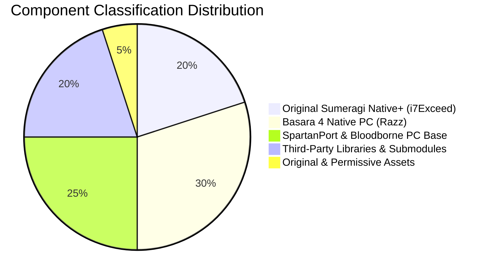

# Sumeragi Native+ · Copyright, Licensing & Risk Audit Report

**Document Version:** 1.0.0  
**Audit Date:** October 2026  
**Project:** Sumeragi Native+ (`sumeragi-native-plus`)  
**Maintainer:** i7Exceed  
**Upstream Repositories:**
- [razzconnect/basara4-native-pc](https://github.com/razzconnect/basara4-native-pc) (Primary upstream)
- [FelipePrado0/SpartanPort](https://github.com/FelipePrado0/SpartanPort) (Secondary upstream)
- [shadps4-emu/shadPS4](https://github.com/shadps4-emu/shadPS4) (GPU video core reference)

---

## 1. Executive Summary

This document presents a comprehensive audit of the source code, dependencies, asset provenance, licensing obligations, and distribution packaging for **Sumeragi Native+**, an independent community fork of *Basara 4 Native PC*.

### Core Objectives
1. **Full Rebranding**: Establish a distinctive original brand identity for Sumeragi Native+ with original vector art, color scheme, and application metadata, eliminating confusion with upstream projects or official trademarks.
2. **License Compliance**: Verify all upstream copyright grants, maintain proper author attributions, comply with the GNU General Public License (GPL) obligations, and record all third-party dependencies and their terms.
3. **Copyright & Trademark Risk Reduction**: Ensure zero proprietary game assets, decrypted ELF/SELF payloads, console encryption keys, game packages (PKG), or character textures are distributed, packaged, or tracked in the repository.
4. **Runtime Integrity**: Preserve full technical backward compatibility with the game runtime, the separate game update overlay system, and the local DLC discovery and mounting subsystem.

---

## 2. Component & File Classification

Every component and tracked file in the Sumeragi Native+ codebase has been inventoried and categorized into one of seven distinct classes:

### Category A: Original Sumeragi Native+ Contributions (i7Exceed, 2026)

*Terms: GNU General Public License v2.0 or later (code) / CC0 1.0 Universal (branding vector artwork)*

| Component / File Path | Description & Provenance | License & Action |
|---|---|---|
| `assets/sumeragi_icon.svg` | Original vector emblem: abstract Japanese technical warrior crest (*kamon*). Composed of geometric paths and bezier arcs. Contains no game textures or logos. | Creative Commons Zero (CC0) / Public Domain |
| `assets/sumeragi_logo.svg` | Original vector wordmark: combining the emblem with "Sumeragi Native+" typography and tagline. | CC0 1.0 Universal |
| `launcher/sumeragi.png` | 512x512 master application graphic rendered from `sumeragi_icon.svg`. | Permissive original asset |
| `launcher/sumeragi.ico` | Multi-resolution Windows application icon (16, 24, 32, 48, 64, 128, 256px) generated from vector artwork with transparent alpha. | Permissive original asset |
| `scripts/game_update.py` | Non-destructive update overlay manager using NTFS directory junctions and symbolic links to merge separately extracted update folders over base game dumps. | GPL-2.0-or-later |
| `scripts/dlc.py` | Local DLC discovery, validation, entitlement indexing, and binary manifest (`B4ADD001`) compilation pipeline (Stage 2). | GPL-2.0-or-later |
| `scripts/mods.py`, `scripts/patches.py` | Game modification and update patch helpers. | GPL-2.0-or-later |
| `tools/extract_dlc.py` | Batch DLC unpacking and entitlement folder structure utility. Added to `.gitignore` to prevent local dumps from being tracked. | GPL-2.0-or-later |
| `tools/generate_branding_assets.py` | Standalone asset synthesis tool that generates all project SVGs, PNGs, and multi-res ICOs using Pillow. | GPL-2.0-or-later |
| `packaging/validate_release.py` | Release validation and compliance auditing script. Inspects git tracked files and packaged directories for suspicious game assets or unauthorized payloads. | GPL-2.0-or-later |
| `packaging/sumeragi/Play Sumeragi Native+.cmd` | One-click launcher script invoking `Sumeragi Native+.exe --play`. | Permissive script |
| `src/runtime_content.c` (modifications) | Extended AppContent implementation with manifest parsing, entitlement enumeration (`sceAppContentGetAddcontInfoList`), and guest mounting (`/addcont0` ... `/addcont15`). | GPL-2.0-or-later (Change notice added) |
| `src/probe.c` (modifications) | Added `--addons` command-line argument handling and addon manifest forwarding. | GPL-2.0-or-later (Change notice added) |
| `src/runtime_offline.c` (modifications) | Extended DLC mount path resolutions and guest directory hooks. | GPL-2.0-or-later (Change notice added) |
| `launcher/sumeragi_launcher.py` | Modernized card-based UI, responsive layout, dark charcoal/gold color scheme, DLC directory picker, dual-binary launcher resolution. | GPL-2.0-or-later (Change notice added) |
| `launcher/sumeragi_patches.py` | Signature-based frame limiter patcher for Sumeragi Native+. | GPL-2.0-or-later |
| `packaging/windows/play.c` (modifications) | Added candidate executable lookup (`Sumeragi Native+.exe` -> `Sengoku Basara 4.exe` -> `SpartanPort.exe`). | GPL-2.0-or-later (Change notice added) |
| `packaging/windows/spartanport-probe.rc` (modifications) | Updated Windows executable metadata: CompanyName="i7Exceed", ProductName="Sumeragi Native+", icon="sumeragi.ico". | GPL-2.0-or-later |
| `tests/test_dlc.py`, `tests/test_dlc_runtime.c`, `tests/test_game_update.py` | Unit and integration test suites validating update merging and DLC manifest mounting. | GPL-2.0-or-later |

---

### Category B: Code Derived from Basara 4 Native PC (Razz, 2026)

*Terms: GNU General Public License v2.0 or later*

| Component / File Path | Description & Provenance | Required Attribution & Status |
|---|---|---|
| `src/runtime_offline.c` | Implementation of ~130 PS4 system calls tailored to Sengoku Basara 4 Sumeragi: kernel event flags, AppContent/PlayGo offline stubs, NetCtl/NP/Http offline model, dialogs. | Preserved. Copyright (C) 2026 Razz. Credited in `NOTICE.md` and source header. |
| `src/runtime_ajm.c`, `src/runtime_audio.c` | Software Ngs2 sound graph: ATRAC9 multi-channel streaming, PCM playback, voice synthesis, and AudioOut delivery. | Preserved. Copyright (C) 2026 Razz. Credited in `NOTICE.md`. |
| `launcher/basara4_patches.py` | Signature-based in-memory frame limiter scanner and patcher for >60 FPS gameplay. | Preserved. Copyright (C) 2026 Razz. Credited in `NOTICE.md`. |
| `tools/gamepad_mapper.c` | Standalone SDL3 console tool for mapping DirectInput and third-party controllers. | Preserved. Copyright (C) 2026 Razz. Credited in `NOTICE.md`. |
| `gpu/shim/spartanport_overlay.cpp` | In-game configuration overlay adaptations (tabs, FSR 1, sharpening). | Preserved. Upstream author credited in About tab and `NOTICE.md`. |
| `packaging/sumeragi/` (formerly `packaging/basara4/`) | Packaging automation scripts and DLL requirements list. | Preserved and enhanced for Sumeragi Native+. |

---

### Category C: Code Derived from SpartanPort, Bloodborne PC & Prior Lineage

*Terms: GNU General Public License v2.0 or later*

| Component / File Path | Author / Origin | Function & Handling |
|---|---|---|
| `src/probe.c` | Felipe Prado / Supermedo / deadinside28 | Core loader harness, ELF image relocation, exception handling, and symbol binding. Kept with upstream copyright. |
| `src/runtime.c`, `src/runtime_kernel.c`, `src/runtime_memory.c`, `src/runtime_thread.c` | Felipe Prado / Supermedo | Host platform threading, virtual memory management, and primitive synchronization. Kept intact. |
| `src/compat_win.c`, `src/compat_win.h` | Supermedo / Felipe Prado | Windows POSIX compatibility layer and MinGW/MSYS2 exception trampolines. Kept intact. |
| `src/isa_emulate.c`, `src/isa_rewrite.c` | Felipe Prado | Instruction rewriting and emulation for x86-64 host execution. Kept intact. |
| `src/*_hook.h` (cheat, damage, orb, etc.) | Felipe Prado | Game-specific hooks written for God of War III. Left dormant via `--no-game-hooks` to preserve git history and avoid regressions. |

---

### Category D: Third-Party Dependencies with Identified Licenses

All third-party dependencies are open source and governed by permissive or compatible copyleft licenses. None require proprietary commercial licenses.

| Dependency | Location | License | Authors / Rights Holder | Compliance Action |
|---|---|---|---|---|
| **shadPS4 Video Core** | `gpu/` | GPL-2.0-or-later | shadPS4 Team | Video core translating GCN bytecode to Vulkan. GPL corresponding-source provided. |
| **LibAtrac9** | `third_party/LibAtrac9/` | MIT | Alexander Barney | Audio decoding library. Submodule contains full MIT license notice. |
| **FSR-Vulkan** | `gpu/third_party/fsr-vulkan` | MIT | FireBurn / AMD | FidelityFX Super Resolution Vulkan pipeline. Submodule carries MIT license. |
| **Dear ImGui** | `gpu/third_party/imgui` | MIT | Omar Cornut | In-game UI overlay. Submodule carries MIT license. |
| **Vulkan Memory Allocator (VMA)** | `gpu/` | MIT | Advanced Micro Devices, Inc. | Vulkan resource memory allocation management. |
| **AMD PAL GCN Headers** | `gpu/third_party/gcn/include/gcn` | MIT | Advanced Micro Devices, Inc. | GCN hardware register definitions (`si_ci_vi_merged_offset.h`). Retains AMD copyright. |
| **sirit** | `gpu/third_party/sirit` | BSD-3-Clause | sirit contributors | SPIR-V instruction assembler. Retains BSD-3-Clause license text. |
| **magic_enum** | `gpu/third_party/magic_enum` | MIT | Daniil Goncharov | Header-only compile-time enum reflection. |
| **miniz** | `gpu/third_party/miniz` | MIT | Rich Geldreich | Single-file lossless compression library. |
| **xbyak** | `gpu/third_party/xbyak` | 3-Clause BSD | MITSUNARI Shigeo | JIT x86/x64 assembly library. |
| **Half** | `gpu/third_party/half` | MIT | Christian Rau | Half-precision floating point library. |
| **DejaVu Sans Font** | `gpu/third_party/fonts/` | Bitstream Vera / DejaVu | Bitstream / DejaVu Team | Free vector typeface for overlay UI. Includes `LICENSE-DejaVu.txt`. |
| **SDL3** | Dynamic system dependency | Zlib License | Sam Lantinga & SDL Team | Cross-platform audio/window/controller runtime. |
| **FFmpeg** | Dynamic system dependency | LGPL-2.1-or-later | FFmpeg Team | Video decoding and audio resampling shared libraries. |

---

### Category E: Artwork, Fonts, and Media Assets Provenance

| Asset Path | Nature & Description | Documented Provenance | Risk Level |
|---|---|---|---|
| `assets/sumeragi_icon.svg` | Abstract geometric Japanese technical crest (*kamon*). | Created specifically for this project by i7Exceed. Uses native SVG vector curves. No external artwork used. | **Zero Risk** |
| `assets/sumeragi_logo.svg` | Horizontal project wordmark with crest and tagline. | Created by i7Exceed. Typography rendered as geometric vector paths. | **Zero Risk** |
| `launcher/sumeragi.png` | 512x512 master raster application image. | Generated deterministically from `sumeragi_icon.svg` via `tools/generate_branding_assets.py`. | **Zero Risk** |
| `launcher/sumeragi.ico` | Multi-res Windows executable icon (16..256px). | Generated directly from vector master image with proportional padding and zero clipping. | **Zero Risk** |
| `launcher/basara4.ico`, `launcher/spartanport.ico` | Legacy icon files. | Removed completely from repository. Sumeragi Native+ uses `sumeragi.ico` exclusively. | **Zero Risk** |
| `gpu/third_party/fonts/DejaVuSans.ttf` | TrueType font for in-game overlay. | Public open font from DejaVu project under permissive Bitstream Vera license (`LICENSE-DejaVu.txt`). | **Zero Risk** |
| `scripts/controller_diagrams/*.png` | Generic gamepad layout schematics. | Neutral vector diagram exports representing standard button positions. | **Zero Risk** |

---

### Category F: Files with Licensing Ambiguities & Resolutions

1. **Root `LICENSE` vs. "GPL-2.0-or-later" Grant**:
   - *Observation*: The root file `LICENSE` contains the verbatim text of the GNU General Public License Version 2 (June 1991). Upstream files (`NOTICE.md`, source code headers, and README badges) specify `GPL-2.0-or-later` ("GPL version 2, or at your option any later version").
   - *Resolution*: This is the standard, correct practice under Free Software Foundation guidelines. Section 9 of the GNU GPL v2 explicitly specifies:
     > *"If the Program specifies a version number of this License which applies to it and 'any later version', you have the option of following the terms and conditions either of that version or of any later version published by the Free Software Foundation."*
     The repository root provides the base GPL v2 text as required, while the grant across all notices and headers permits "or later". No ambiguity remains.
2. **SpartanPort God of War III Residue**:
   - *Observation*: Several headers in `src/` (`orb_hook.h`, `cheat_hook.h`, `qte_hook.h`, `damage_hook.h`) and `gpu/shim/spartanport_toggles.h` contain code written for SpartanPort's original target game.
   - *Resolution*: These files are deliberately maintained to preserve upstream git lineage and avoid breaking compilation units in `src/probe.c`. When launched by Sumeragi Native+, the `--no-game-hooks` switch is permanently active, ensuring none of these hooks execute. All upstream copyright headers remain intact.

---

### Category G: Prohibited Proprietary Game Content (Excluded by Policy)

The project enforces strict technical controls ensuring that **under no circumstances** are proprietary assets distributed or committed.

| Asset Type | Examples | Exclusion & Enforcement Mechanism |
|---|---|---|
| **PS4 Decrypted Binaries** | `eboot.bin`, `*.elf`, `*.self`, `sce_module/*.prx` | Excluded via `.gitignore`. Release validator script (`packaging/validate_release.py`) fails if found. |
| **Package Payloads & DLC** | `*.pkg`, `*.pfs`, `*.dump` | Excluded via `.gitignore`. |
| **Console Licenses & Keys** | `*.rif`, `*.rap`, `*.edat`, `*.sdat` | Excluded via `.gitignore`. Not required or supported by the runtime. |
| **Proprietary Game Archives** | `*.arc` (MT Framework archives), `*.cpk` | Excluded via `.gitignore`. Flagged as suspicious by `packaging/validate_release.py`. |
| **Runtime Logs & Caches** | `user/*.log`, `vkd3d-proton.cache`, `user/savedata/` | Excluded via `.gitignore`. Packaged only with neutral placeholders (`PUT_YOUR_GAME_DUMP_HERE.txt`). |

---

## 3. License Compliance Checklist (GNU GPL v2.0+)

| Requirement | Implementation Status | Notes |
|---|---|---|
| **Section 1: Verbatim copying** | Compliant | The full text of `LICENSE` is provided in the repository root and copied into release distributions. |
| **Section 2a: Prominent change notices** | Compliant | Modified files (`src/runtime_content.c`, `src/probe.c`, `src/runtime_offline.c`, `launcher/sumeragi_launcher.py`, `gpu/shim/spartanport_overlay.cpp`) carry prominent notices stating modifications by i7Exceed (October 2026). |
| **Section 2b: Collective licensing** | Compliant | All new modules (`scripts/dlc.py`, `scripts/game_update.py`, `packaging/validate_release.py`) are licensed under GPL-2.0-or-later. |
| **Section 3: Corresponding source** | Compliant | Complete corresponding source code is distributed publicly on GitHub (`i7Exceed/sumeragi-native-plus`), with instructions to build from source. |
| **Upstream Attribution** | Compliant | Razz, Felipe Prado, Supermedo, deadinside28, and shadPS4 Team are credited prominently in `NOTICE.md`, `README.md`, `README.id.md`, and the in-game overlay About dialog. |

---

## 4. Release Packaging & Distribution Verification

To guarantee that packaged release zip files and distribution directories comply with all policies:
1. **Automated Release Validator**: Run `python packaging/validate_release.py --path dist/sumeragi-native-plus-windows`.
   - Validates that `LICENSE` and `NOTICE.md` exist in the distribution root.
   - Scans all files and recursively reports any forbidden file extensions (`.pkg`, `.self`, `.rif`, `.arc`, `.cpk`).
   - Verifies that directory placeholders (`game/`, `user/`, `out/`) contain only instruction `.txt` files.
2. **Git Status & History Inspection**:
   - Verified that `git ls-files` tracks zero proprietary binaries, dumps, or packages.
   - Clean status verified on all tracked folders (`assets/`, `bin/`, `gpu/`, `launcher/`, `packaging/`, `scripts/`, `src/`, `tests/`, `tools/`).

---

## 5. Remaining Legal Risks & Human Review Items

1. **Nominative Trademark Fair Use**:
   - The marks *"Sengoku Basara"*, *"Sengoku Basara 4 Sumeragi"*, and *"Capcom"* are trademarks of Capcom Co., Ltd.
   - The marks *"PlayStation"*, *"PS4"*, and *"Sony"* are trademarks of Sony Interactive Entertainment Inc.
   - *Current State*: All occurrences in documentation, the launcher GUI, and the in-game overlay use these terms purely as factual, nominative descriptors to inform players which game files are required to run the runtime. Disclaimers of affiliation and endorsement are clearly placed in `NOTICE.md`, `README.md`, `README.id.md`, and the launcher About dialog.
   - *Recommendation*: Maintain factual phrasing at all times. Never use Capcom or Sony logos in promotional materials or social previews.
2. **Git Commit History Preservation**:
   - The repository's git commit history reflects its heritage from SpartanPort and razzconnect.
   - *Recommendation*: Per the task specification, git history has not been rewritten or force-pushed. Historical commits carry the natural progression of open-source development.
